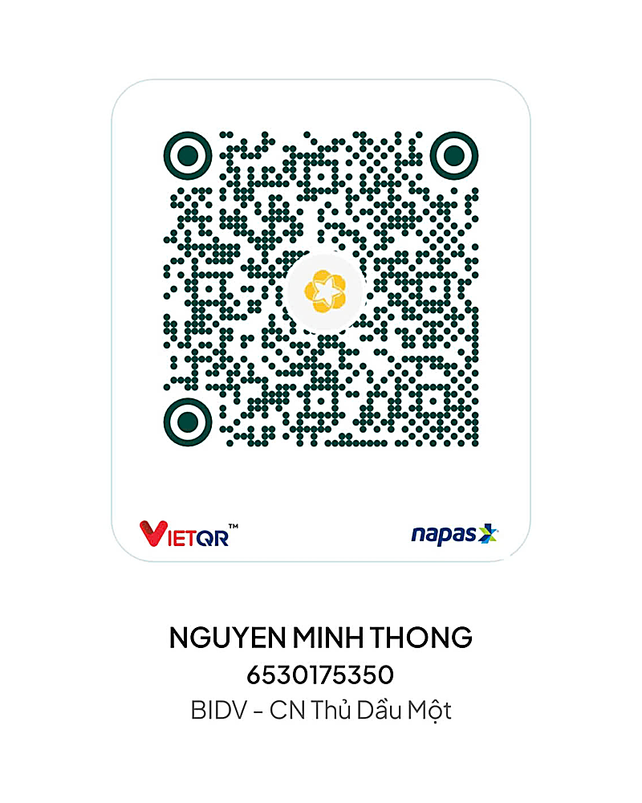
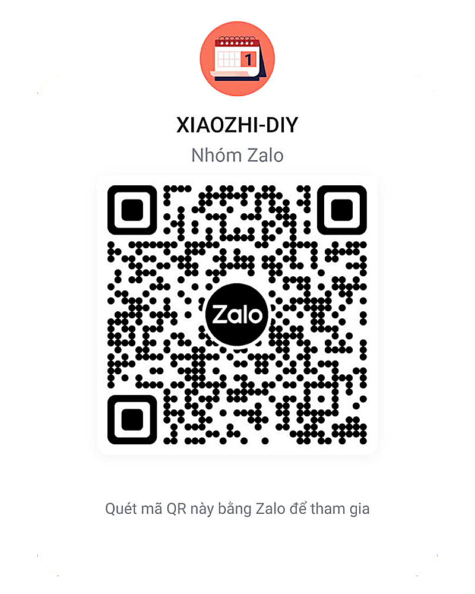

# Xiaozhi-ESP32 — ESP32-S3-N16R8

Hướng dẫn cấu hình, biên dịch, nạp firmware và khắc phục lỗi cho board **ESP32-S3-N16R8** (16 MB Octal Flash, 8 MB Octal PSRAM) với ESP-IDF 6.1.

---

## Mục lục

1. [Yêu cầu](#1-yêu-cầu)
2. [Cấu hình phần cứng bằng Web Configurator](#2-cấu-hình-phần-cứng-bằng-web-configurator)
3. [Sơ đồ chân GPIO](#3-sơ-đồ-chân-gpio)
4. [Biên dịch và nạp firmware](#4-biên-dịch-và-nạp-firmware)
5. [Khắc phục lỗi thường gặp](#5-khắc-phục-lỗi-thường-gặp)
6. [Tài liệu bổ sung](#6-tài-liệu-bổ-sung)
7. [Liên hệ và ủng hộ](#7-liên-hệ-và-ủng-hộ)

---

## 1. Yêu cầu

| Thành phần | Ghi chú |
| :--- | :--- |
| Hệ điều hành | Windows 10/11 |
| ESP-IDF | **6.1**, cài bằng ESP-IDF Windows installer, target `esp32s3` |
| Python | Đi kèm ESP-IDF; cần Python 3 nếu chạy Web Configurator |
| Trình duyệt | Google Chrome hoặc Microsoft Edge |
| Board | ESP32-S3-N16R8 (16 MB Flash, 8 MB PSRAM) |
| Cáp | Cáp USB hỗ trợ truyền dữ liệu (không phải cáp chỉ sạc) |

---

## 2. Cấu hình phần cứng bằng Web Configurator

Web Configurator giúp chọn chân GPIO, màn hình, codec âm thanh, camera, cảm biến và ngoại vi mà không cần sửa mã C/C++ bằng tay.

### 2.1 Mở công cụ

Chọn một trong các cách sau:

- **Cách 1 (khuyên dùng):** nhấp đúp `run_configurator.bat` ở thư mục gốc dự án. Công cụ tự mở trình duyệt tại `http://localhost:8080`, nạp cấu hình hiện có và cho phép lưu trực tiếp vào mã nguồn.
- **Cách 2:** nhấp đúp `tools/web-configurator/start_configurator.bat`.
- **Cách 3:** mở `configurator.html` hoặc `tools/web-configurator/index.html` bằng trình duyệt. Cách này không lưu được trực tiếp vào dự án, chỉ dùng để xem trước.

### 2.2 Các tab cấu hình

| Tab | Nội dung |
| :--- | :--- |
| Trợ lý (Assistant) | Ngôn ngữ, địa chỉ OTA, Wake Word, xử lý âm thanh và khử tiếng vọng (AEC) |
| Màn hình (Display) | Màn hình, cảm ứng, gói tài nguyên giao diện |
| Âm thanh (Audio) | Loa và micro; âm thông báo cho từng sự kiện (khởi động, lắng nghe, lỗi, pin yếu...): chọn âm có sẵn, tắt tiếng hoặc tệp `.ogg` riêng (`docs/NOTIFICATION_SOUNDS.md`) |
| Mạng (Network) | Phương thức cấu hình WiFi, UART mở rộng, module Bluetooth UART, MCP Server |
| Ngoại vi (Peripherals) | Nút bấm, camera, LED, còi, rung, servo, cảm biến, motor, relay |
| Nguồn & viễn thông (Power) | Pin, bộ sạc, RTC, NFC, thẻ SD, 4G, hồng ngoại |
| Hệ thống (System) | CPU, Flash, PSRAM, bảng phân vùng |
| Biên dịch & Nạp (Build) | Build, flash, xem log, chọn ESP-IDF, target và cổng COM |

### 2.3 Lưu và kiểm tra cấu hình

- Nút **Lưu** nằm ở góc trên bên phải mỗi tab. Lưu sẽ ghi toàn bộ cấu hình, không chỉ tab hiện tại.
- Khi chuyển tab mà còn thay đổi chưa lưu, hộp thoại cho bạn chọn **Lưu rồi chuyển**, **Bỏ thay đổi** hoặc **Ở lại**.
- Nếu hai chức năng dùng cùng một chân GPIO, nút Lưu bị khoá và báo trùng chân. Gỡ một trong hai rồi lưu lại.
- Nhiều thiết bị có thể dùng chung bus I2C/SPI nếu cùng vai trò (SDA nối SDA, SCK nối SCK).
- Mở thẳng một tab bằng URL, ví dụ `http://localhost:8080/#panel-build`.

### 2.4 Cấu hình được ghi vào đâu

Sau khi lưu, cấu hình được ghi vào:

- `sdkconfig.defaults`: cấu hình gốc của dự án, nên đưa vào git.
- `sdkconfig`: cấu hình build hiện tại, tự sinh ra khi build.

Bạn cũng có thể dùng `idf.py menuconfig` trong terminal. Web Configurator đọc lại `sdkconfig` khi mở, nên thay đổi từ menuconfig sẽ hiện lên giao diện web.

---

## 3. Sơ đồ chân GPIO

Các chân dưới đây là quy tắc bắt buộc cho ESP32-S3-N16R8. Web Configurator đã kiểm tra trước khi cho lưu, nhưng bạn cũng nên biết để tránh xung đột khi đấu nối phần cứng.

| Nhóm chân | GPIO | Lưu ý |
| :--- | :--- | :--- |
| Octal Flash & Octal PSRAM | **26 – 37** | **Không được dùng.** Dùng nội bộ cho bộ nhớ, Web Configurator sẽ khoá. |
| USB Serial/JTAG | 19, 20 | Dùng cho nạp và debug. Hạn chế dùng làm chân thường. |
| Strapping | 0, 3, 45, 46 | Ảnh hưởng chế độ khởi động. GPIO 0 là nút BOOT. |
| LED WS2812 tích hợp | 48 | Đèn trạng thái, bật sẵn. Màu và hiệu ứng theo từng trạng thái chọn trong menuconfig mục 4.2. |
| LED đơn do chatbot điều khiển | Tự chọn (danh sách chân) | Mục 4.2 → "LED đơn GPIO". 4 LED đầu chỉnh được độ sáng (LEDC kênh 1, 3, 6, 7). Thêm LED qua PCA9685, IC LED hoặc IC mở rộng: [docs/MCP_TOOLS.md](docs/MCP_TOOLS.md) mục 6.1. |
| I2S loa | 14, 15, 7, 2 | BCLK, WS, DOUT, PA (bật amply). |
| I2S micro | 4, 5, 6 | SCK, WS, DIN. |
| I2C (cảm ứng, cảm biến, codec) | 8 (SDA), 9 (SCL) | Dùng chung cho OLED, ToF, codec ES8311. |
| Cảm ứng màn hình | 8, 9, 3, 10 | I2C + INT (3) + RST (10). |
| UART màn hình rời | 17 (TX), 18 (RX) | UART_NUM_1. Giao thức: [docs/UART_DISPLAY_PROTOCOL.md](docs/UART_DISPLAY_PROTOCOL.md). Có thể chạy không dây qua module Bluetooth. |
| Module Bluetooth UART (HC-05/HC-06/HM-10) | TX, RX, STATE, KEY tự chọn (mặc định -1) | Cổng UART riêng (mặc định UART2). Hướng dẫn: [docs/BLUETOOTH_UART.md](docs/BLUETOOTH_UART.md), cài đặt hai đầu: [docs/BLUETOOTH_MODULE_SETUP.md](docs/BLUETOOTH_MODULE_SETUP.md). |
| Servo PWM | 13 | 50 Hz, LEDC timer 2. |
| Relay / đèn | 45 | Liên kết với MCP. |
| Thanh trượt cảm ứng | 1, 2, 3 | Touch pad nội bộ. |
| Nút âm lượng | 47, 48 hoặc chân tự do | Pull-up nội bộ. |
| Ngoại vi mở rộng | 1, 2, 4–7, 10–18, 21, 38–44, 47 | Dùng tự do cho buzzer, rung, motor, encoder, SD, Ethernet... |

Chân không dùng đến được đặt là `-1`. Với cấu hình mặc định, không chân nào bị gán ngẫu nhiên, nên khởi động không bị lỗi.

---

## 4. Biên dịch và nạp firmware

### 4.1 Biên dịch từ Web Configurator

Vào tab **Biên dịch & Nạp**, bấm Build. Log hiển thị trực tiếp trong trình duyệt.

### 4.2 Biên dịch bằng dòng lệnh

Nhấp đúp `02-build_esp32s3.bat` ở thư mục gốc dự án. Script:

1. Tự tìm ESP-IDF 6.1 (bản cài bằng ESP-IDF Installation Manager hoặc bản cài cũ) và nạp môi trường.
2. Tự `set-target esp32s3` nếu thư mục chưa ở target này; đã đúng thì bỏ qua (set-target xoá `sdkconfig`).
3. Hiện menu: `menuconfig`, `build`, hoặc làm lại set-target.

Để nạp firmware và xem log, dùng `idf.py -p COMx flash monitor` trong ESP-IDF terminal (mục 4.4). Thay `COMx` bằng cổng thực tế của board (xem trong Device Manager).

### 4.3 Cấu hình chi tiết bằng menuconfig

1. Nhấp đúp `01 set-UTF8-Fix-windows.bat` một lần để bật UTF-8 cho Windows, sau đó **mở terminal mới**.
2. Chạy:
   ```powershell
   idf.py menuconfig
   ```

### 4.4 Nạp và xem log

Trong ESP-IDF terminal:

```bash
idf.py -p COM3 flash monitor
```

Thoát monitor bằng `Ctrl + ]`.

### 4.5 Đưa board vào chế độ nạp

Nếu nạp không được (xem mục 5), giữ nút **BOOT** (GPIO 0), nhấn và thả **RESET**, rồi thả **BOOT**. Sau đó chạy lại lệnh nạp.

---

## 5. Khắc phục lỗi thường gặp

### 5.1 Web Configurator

| Triệu chứng | Nguyên nhân thường gặp | Cách xử lý |
| :--- | :--- | :--- |
| `run_configurator.bat` báo không có Python | Chưa cài Python hoặc không nằm trong PATH | Cài ESP-IDF (có Python đi kèm) hoặc cài Python 3, rồi chạy lại. |
| Trình duyệt không mở được `localhost:8080` | Cổng 8080 đang bị chương trình khác dùng | Công cụ tự chuyển sang cổng từ 8081 đến 8099. Xem địa chỉ trong cửa sổ terminal. |
| Nút Lưu bị khoá, báo trùng chân | Hai chức năng cùng dùng một GPIO | Đổi chân của một chức năng, hoặc chọn `-1` nếu không dùng. |
| Lưu xong nhưng code không đổi | Đang mở HTML trực tiếp, không qua server | Dùng `run_configurator.bat` để lưu vào dự án. |
| Chọn chân 26–37 bị từ chối | Dải này là bộ nhớ Octal Flash/PSRAM | Chọn chân khác, xem mục 3. |
| Giao diện lỗi tiếng Việt | Terminal chưa dùng UTF-8 | Chạy `01 set-UTF8-Fix-windows.bat`, mở terminal mới. |
| Đã sửa `main/Kconfig.projbuild` nhưng web không cập nhật | Giao diện chưa được sinh lại | Chạy `tools/web-configurator/sync_menuconfig.bat`. |

### 5.2 Biên dịch

| Triệu chứng | Nguyên nhân thường gặp | Cách xử lý |
| :--- | :--- | :--- |
| `Khong tim thay ESP-IDF 6.1` | Không tìm thấy ESP-IDF 6.1 | Cài ESP-IDF 6.1 bằng ESP-IDF Installation Manager, hoặc mở terminal ESP-IDF 6.1 rồi chạy `02-build_esp32s3.bat` từ đó. |
| `Missing file ... .h` hoặc `undefined reference` | Sau khi thêm hoặc đổi tên file, CMake chưa cập nhật | Xoá thư mục `build/` và build lại. |
| Build báo lỗi chữ tiếng Việt hoặc ký tự lạ | Terminal chưa dùng UTF-8 | Chạy `01 set-UTF8-Fix-windows.bat`, mở terminal mới. |
| Đổi cấu hình nhưng firmware vẫn như cũ | Chưa build lại sau khi lưu | Lưu trên Web Configurator, rồi build lại. Nếu cần, xoá `sdkconfig` để sinh lại từ `sdkconfig.defaults`. |
| Build lỗi sau khi chuyển board | `sdkconfig` cũ còn giữ target khác | Xoá `build/` và `sdkconfig`, rồi chạy `idf.py set-target esp32s3`. |

### 5.3 Nạp firmware và khởi động

| Triệu chứng | Nguyên nhân thường gặp | Cách xử lý |
| :--- | :--- | :--- |
| Không tìm thấy cổng COM | Cáp chỉ sạc, thiếu driver, hoặc board chưa được cấp nguồn | Thay cáp dữ liệu, kiểm tra Device Manager, thử cổng USB khác. |
| `Failed to connect to ESP32-S3` | Board chưa vào chế độ nạp | Làm theo mục 4.5 (giữ BOOT, nhấn RESET). |
| Board khởi động lại liên tục | Lỗi bộ nhớ, PSRAM cấu hình sai, hoặc chân bị xung đột | Xem log bằng `idf.py monitor`. Kiểm tra mục Hệ thống (System) trong Web Configurator và các chân ở mục 3. |
| Log báo `Guru Meditation Error` hoặc `LoadProhibited` | Truy cập bộ nhớ không hợp lệ | Chụp đoạn log quanh lỗi, kiểm tra cấu hình ngoại vi vừa thay đổi. |
| Log báo `Out of memory` | Thiếu RAM hoặc PSRAM chưa bật | Kiểm tra cấu hình PSRAM trong tab Hệ thống, và bảng phân vùng `partitions.csv`. |
| `Interrupt wdt timeout` | Một tác vụ chiếm CPU quá lâu | Ghi lại tên tác vụ trong log và báo lại. |

### 5.4 Phần cứng

| Triệu chứng | Kiểm tra |
| :--- | :--- |
| Màn hình trắng hoặc đen | Chân SPI/I2C đúng với Web Configurator, nguồn 3.3 V ổn định, đúng driver màn hình. |
| Loa không có tiếng | Chân I2S (BCLK, WS, DOUT), chân PA bật amply, mức điện áp codec. |
| Micro không thu được | Chân I2S micro (SCK, WS, DIN), chọn đúng loại micro trong Web Configurator. |
| Cảm ứng không nhận | Địa chỉ I2C, chân INT và RST, loại chip (CST816S, GT911, FT6236). |
| Thiết bị I2C báo timeout | Điện trở kéo lên trên SDA/SCL, đấu nối không bị chạm, không trùng địa chỉ. |
| Nút BOOT ảnh hưởng khởi động | GPIO 0 là strapping pin, không nối tải mạnh vào chân này. |

---

## 6. Tài liệu bổ sung

| Tài liệu | Nội dung |
| :--- | :--- |
| [docs/MCP_TOOLS.md](docs/MCP_TOOLS.md) | Danh sách công cụ MCP: chatbot đọc cảm biến và điều khiển phần cứng bằng hàm nào, tham số, dữ liệu trả về, địa chỉ I2C. |
| [docs/LED_GROUPS_PLAN.md](docs/LED_GROUPS_PLAN.md) | Các nhóm LED: LED trạng thái, LED đơn GPIO, PCA9685, IC LED, IC mở rộng; bảng phân kênh LEDC. |
| [docs/PROMPT_XIAOZHI.md](docs/PROMPT_XIAOZHI.md) | Prompt mẫu để dán vào ô mô tả vai trò trên xiaozhi.me. |
| [Danh_Sach_Kconfig_WebUI.md](Danh_Sach_Kconfig_WebUI.md) | Danh sách đầy đủ các mục cấu hình hiển thị trên Web Configurator. |
| [partitions/README.md](partitions/README.md) | Cách bố trí bảng phân vùng Flash. |
| [partitions.csv](partitions.csv) | Bảng phân vùng đang dùng. |
| [main/boards/esp32-p4/docs/](main/boards/esp32-p4/docs/) | Sơ đồ nguyên lý và sơ đồ khối của board ESP32-P4 (khác với board chính). |
| [sdkconfig.defaults.esp32s3](sdkconfig.defaults.esp32s3) | Cấu hình mặc định cho ESP32-S3. |
| [sdkconfig.defaults.esp32p4](sdkconfig.defaults.esp32p4) | Cấu hình mặc định cho ESP32-P4. |
| [tools/web-configurator/](tools/web-configurator/) | Mã nguồn Web Configurator và các script kiểm thử. |
| [tools/clean_comments.py](tools/clean_comments.py) | Công cụ xoá comment trong mã nguồn trước khi xuất bản. |

### 6.1 Kiểm thử Web Configurator (dành cho lập trình viên)

Chạy `tools/web-configurator/run_all_tests.bat`. Lần đầu cần chạy `npm install` trong thư mục `tools/web-configurator/`.

### 6.2 Sau khi sửa Kconfig

Chạy `tools/web-configurator/sync_menuconfig.bat` để sinh lại giao diện Web và cập nhật `Danh_Sach_Kconfig_WebUI.md`. Cần đã build một lần, ví dụ `idf.py -B build_sim reconfigure`.

---

## 7. Liên hệ và ủng hộ

- **Nhóm Zalo:** https://zalo.me/g/fkyi7ksh3rcddiqvkufu
- **YouTube:** https://www.youtube.com/@tuyhung-diy
- **TikTok:** https://www.tiktok.com/@gocdiy
- **GitHub:** https://github.com/minhthongvgt/xiaozhi-diy

### Ủng hộ dự án qua BIDV

Quét mã QR bằng ứng dụng ngân hàng BIDV:



### Tham gia nhóm Zalo

Quét mã QR bằng Zalo để vào nhóm:


