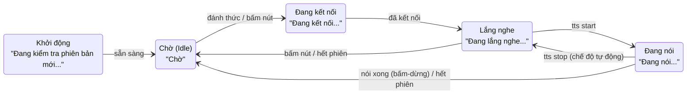

# Giao thức màn hình rời UART – Xiaozhi ESP32

Cập nhật: 2026-10-12

## Tổng quan

Firmware Xiaozhi gửi trạng thái chatbot ra một cổng UART theo **một chiều** (ESP32 → màn hình rời). Màn hình rời chỉ cần nhận và hiển thị; firmware hiện **không đọc** dữ liệu gửi ngược về. Mã nguồn: `main/display/uart_display.cc`.

Có hai cách dùng:

- **Màn hình chính là UART** (`CUSTOM_DISPLAY_UART`): mọi nội dung hiển thị chỉ đi ra UART.
- **Song song 2 màn hình** (`ENABLE_CUSTOM_SECONDARY_UART_DISPLAY`): màn LCD/OLED trên board vẫn chạy, và mọi lệnh hiển thị được sao chép ra UART qua lớp `DualDisplay`.

Mỗi khi ứng dụng đổi trạng thái (chờ, nghe, nói…), nhận câu nói (STT), câu trả lời (TTS) hay cảm xúc từ server, firmware gọi một hàm hiển thị. `UartDisplay` dịch lời gọi đó thành một khung dữ liệu theo giao thức đã chọn: **Nextion/TJC**, **JSON**, **Raw text** hoặc **DWIN DGUS**.

Không được gửi qua UART: icon Wi-Fi, pin, đồng hồ (hàm `UpdateStatusBar` của UART để trống), hình emoji/GIF, ảnh xem trước camera và mức âm lượng.

## Đấu nối và cấu hình

Chỉ cần 3 dây: **TX của ESP32 → RX của màn hình**, GND chung, và nguồn cho màn hình. Khung truyền cố định **8N1** (8 bit dữ liệu, không parity, 1 stop bit), không dùng bắt tay phần cứng.

| Tuỳ chọn menuconfig | Giá trị | Ghi chú |
| --- | --- | --- |
| `CUSTOM_DISPLAY_UART` hoặc `ENABLE_CUSTOM_SECONDARY_UART_DISPLAY` | bật | UART là màn chính, hoặc chạy song song màn LCD/OLED |
| `CUSTOM_DISPLAY_UART_PORT` | 1 hoặc 2 (mặc định 1) | Không dùng UART0 (nạp firmware và log). Khi màn hình dùng UART1, cổng UART tùy biến khác tự chuyển sang UART2 |
| `CUSTOM_DISPLAY_UART_TX_PIN` | GPIO (mặc định -1) | **Bắt buộc**. -1 thì firmware bỏ qua màn hình UART. Tránh GPIO 26–37 (Flash/PSRAM Octal) |
| `CUSTOM_DISPLAY_UART_RX_PIN` | GPIO hoặc -1 | Không bắt buộc. Hiện firmware chưa đọc dữ liệu từ chân này |
| Baudrate | 9600 – 921600 (mặc định 115200) | Phải trùng với màn hình. Nextion xuất xưởng chạy 9600 |
| Giao thức | Nextion/TJC, JSON, Raw text, DWIN DGUS | Mặc định Nextion/TJC |

Mức điện áp: chân ESP32-S3 là **3,3 V**. Nextion/TJC và DWIN nhận được 3,3 V TTL trên chân RX. Màn hình dùng mức 5 V hay RS-232 thì cần mạch chuyển mức. Không nối TX 5 V của màn hình thẳng vào chân RX của ESP32.

Nếu chân TX sai hoặc cài driver UART lỗi, log sẽ báo `Secondary UART Display failed to initialize` và thiết bị chạy tiếp không có màn hình rời. Khi khởi tạo thành công, firmware gửi ngay trạng thái `Connected`, có thể dùng để kiểm tra đường dây.

## Trạng thái và sự kiện được gửi

Firmware gửi 7 loại tin. Trạng thái thiết bị **không có mã số riêng**: màn hình nhận biết trạng thái qua chuỗi `status`, vốn là văn bản theo ngôn ngữ đã chọn khi build (bảng dưới dùng tiếng Việt, `vi-VN`).

| Loại tin | Hàm trong firmware | Nội dung |
| --- | --- | --- |
| status | `SetStatus` | Dòng trạng thái ngắn (bảng 2) |
| notify | `ShowNotification` | Thông báo tạm thời, ví dụ “Đang quét Wi-Fi...”. Firmware không gửi lệnh xoá: màn hình tự ẩn sau vài giây (LCD trên board dùng 3 s) |
| emotion | `SetEmotion` | Tên cảm xúc (bảng 3) |
| chat | `SetChatMessage` | `role` = `user` (câu người nói), `assistant` (câu AI trả lời) hoặc `system` (tin hệ thống). Nội dung rỗng = xoá dòng đó |
| clear_chat | `ClearChatMessages` | Xoá cả câu người dùng lẫn câu AI |
| power | `SetPowerSaveMode` | `sleep` khi vào tiết kiệm điện, `wake` khi thoát |
| (khởi động UART) | `SetStatus("Connected")` | Gửi một lần khi UART khởi tạo xong |



Màn hình có thể bám theo chuỗi status để biết thiết bị đang ở bước nào. Từ Lắng nghe hoặc Đang nói, bấm nút hay hết phiên đều quay về Chờ.

**Bảng 2 – Trình tự tin theo trạng thái thiết bị**

| Trạng thái / sự kiện | status | emotion | chat |
| --- | --- | --- | --- |
| Khởi động | `Đang kiểm tra phiên bản mới...` | – | `system`: chuỗi User-Agent (tên board/phiên bản) |
| Tải tài nguyên (assets) | `Đang tải tài nguyên...` | `cloud_download` | `system`: `Vui lòng đợi...` rồi tiến độ |
| Kích hoạt thiết bị | `Kích hoạt` | `link` | `system`: hướng dẫn và mã kích hoạt |
| Đăng nhập server | `Đang đăng nhập...` | – | – |
| Chờ (Idle) | `Chờ` | `neutral` | `clear_chat` |
| Đang kết nối | `Đang kết nối...` | `neutral` | `system`: rỗng |
| Lắng nghe | `Đang lắng nghe...` | `neutral` | `user`: câu nhận dạng được (STT) |
| Đang nói | `Đang nói...` | do server gửi (`llm`) | `assistant`: từng câu khi bắt đầu phát |
| Phát thông báo từ server | `Đang nói...` | – | `assistant`: phụ đề theo thời gian |
| Cập nhật firmware (OTA) | tên bước OTA | `download` | `system`: `45% 120KB/s`…, cuối cùng `Upgrade successful, rebooting...` |
| Lỗi | `Lỗi` | `warning`, `cancel` hoặc `cloud_off` | `system`: nội dung lỗi |
| Server gửi cảnh báo (`alert`) | do server gửi | do server gửi | `system`: do server gửi |
| Tin tùy biến (`custom`, nếu bật `RECEIVE_CUSTOM_MESSAGE`) | – | – | `system`: chuỗi JSON payload |

Các `notify` hay gặp: `Phiên bản x.y.z`, `Đang quét Wi-Fi...`, `Đang vào chế độ cấu hình Wi-Fi...`, `Bật AEC` / `Tắt AEC`, `Đang chuyển sang 4G...` / `Đang chuyển sang Wi-Fi...`.

**Bảng 3 – Giá trị emotion**

- **21 cảm xúc từ AI** (tin `llm` của server): `neutral`, `happy`, `laughing`, `funny`, `sad`, `angry`, `crying`, `loving`, `embarrassed`, `surprised`, `shocked`, `thinking`, `winking`, `cool`, `relaxed`, `delicious`, `kissy`, `confident`, `sleepy`, `silly`, `confused`. Khớp với bộ 21 ảnh GIF `otto-emoji-gif-component` mà dự án đang dùng.
- **Biểu tượng hệ thống** (do firmware gửi): `robot_2`, `link`, `cloud_download`, `cloud_off`, `download`, `warning`, `cancel`.
- Server có thể gửi tên khác (tin `alert`), nên màn hình cần có hình dự phòng cho tên lạ, ví dụ dùng `neutral`.

## Định dạng khung theo giao thức

Mọi văn bản được gửi dạng **UTF-8**: một chữ tiếng Việt có dấu chiếm 2–3 byte (ví dụ `ờ` = `E1 BB 9D`). Firmware không gửi mã trạng thái số, chỉ gửi văn bản.

| Loại tin | Nextion / TJC (+ `FF FF FF`) | JSON (mỗi tin 1 dòng, kết thúc `\n`) | Raw text (kết thúc `\r\n`) | DWIN DGUS (địa chỉ VP) |
| --- | --- | --- | --- | --- |
| status | `t_status.txt="…"` | `{"type":"status","val":"…"}` | `STATUS:…` | `0x1000` |
| notify | `t_notify.txt="…"` | `{"type":"notify","val":"…"}` | `NOTIFY:…` | `0x1100` |
| emotion | `t_emotion.txt="…"` | `{"type":"emotion","val":"…"}` | `EMOTION:…` | `0x1200` |
| chat `user` | `t_user.txt="…"` | `{"type":"chat","role":"user","content":"…"}` | `CHAT:user:…` | `0x1300` |
| chat `assistant` / `system` | `t_chat.txt="…"` | `{"type":"chat","role":"assistant","content":"…"}` (hoặc `system`) | `CHAT:assistant:…` | `0x1400` |
| clear_chat | `t_user.txt=""` và `t_chat.txt=""` | `{"type":"clear_chat"}` | `CLEAR_CHAT` | ghi chuỗi rỗng vào `0x1300` và `0x1400` |
| power | `sleep=1` / `sleep=0` | `{"type":"power","state":"sleep"}` / `"wake"` | `SLEEP` / `WAKE` | không gửi |

### Nextion / TJC

Mỗi lệnh là chuỗi ASCII theo sau 3 byte `0xFF 0xFF 0xFF`. Trang đang hiển thị cần có 5 ô Text tên `t_status`, `t_notify`, `t_emotion`, `t_user`, `t_chat`. Firmware không gửi lệnh đổi trang và không thêm tiền tố tên trang.

```
t_status.txt="Chờ"  FF FF FF
t_chat.txt="Xin chào, bạn cần gì?"  FF FF FF
```

- Firmware chỉ đổi `"` thành `\"` và bỏ ký tự `\r`. Dấu `\` trong nội dung **không** được thoát, nên một câu trả lời chứa `\` có thể làm hỏng lệnh.
- Đặt thuộc tính `txt_maxl` của `t_chat` và `t_user` đủ lớn: câu trả lời của AI thường dài hơn 100 byte.
- Font trên màn hình phải được tạo với bảng mã UTF-8 và có đủ chữ tiếng Việt; ký tự ngoài bảng mã sẽ hiện thành `?`.
- `sleep=1` / `sleep=0` là biến hệ thống của Nextion: vào và thoát ngủ, khi thoát trang được vẽ lại.

### JSON

Mỗi tin là một đối tượng JSON trên một dòng, kết thúc bằng `\n`. Ký tự xuống dòng và dấu ngoặc kép trong nội dung đã được thoát chuẩn JSON, nên đây là lựa chọn an toàn nhất khi tự làm màn hình bằng vi điều khiển.

```
{"type":"status","val":"Đang lắng nghe..."}
{"type":"chat","role":"user","content":"Hôm nay thời tiết thế nào?"}
{"type":"status","val":"Đang nói..."}
{"type":"emotion","val":"thinking"}
{"type":"chat","role":"assistant","content":"Hôm nay trời nắng, khoảng 31 độ."}
{"type":"status","val":"Chờ"}
{"type":"clear_chat"}
{"type":"emotion","val":"neutral"}
```

### Raw text

Mỗi tin là `KHÓA:nội dung` kết thúc `\r\n`; tin chat có thêm vai trò: `CHAT:assistant:Xin chào`. Nội dung **không được thoát**: nếu câu trả lời chứa xuống dòng thì một tin bị tách thành nhiều dòng. Khi tách `CHAT`, chỉ cắt ở 2 dấu `:` đầu tiên vì nội dung có thể chứa `:`.

### DWIN DGUS

Mỗi tin là lệnh ghi biến `0x82`: `5A A5` + độ dài + `82` + địa chỉ VP (2 byte) + văn bản + `00 00`. Byte độ dài = số byte tính từ `82` đến hết.

```
status "Connected" → 5A A5 0E 82 10 00 43 6F 6E 6E 65 63 74 65 64 00 00
```

- Văn bản bị cắt ở **240 byte**. Do cắt theo byte, chữ tiếng Việt ở cuối có thể bị cắt giữa chừng.
- Trong DGUS, đặt mỗi ô hiển thị văn bản (Text Display) đúng địa chỉ VP ở bảng trên và dành đủ vùng nhớ cho nó: các VP cách nhau `0x100` (256 word).
- Màn hình trả lời mỗi lệnh ghi bằng `5A A5 03 82 4F 4B` (“OK”); firmware bỏ qua các byte này.
- Firmware gửi UTF-8, nhưng ô văn bản DWIN thường cài bảng mã ASCII/GBK/Unicode. Cần kiểm tra trong DGUS rằng bảng mã và font của ô hiển thị đúng tiếng Việt UTF-8. Chưa kiểm chứng được trên thiết bị thật.

## Chiều ngược lại: màn hình gửi về ESP32

Hiện **chưa hỗ trợ**. Firmware cài bộ đệm nhận 512 byte và cấu hình chân RX, nhưng không có đoạn mã nào đọc dữ liệu. Nút bấm hay cảm ứng trên màn hình rời sẽ không điều khiển được chatbot.

Dữ liệu màn hình tự gửi về cũng bị bỏ qua:

- **Nextion**: mã lỗi (ví dụ `02 FF FF FF` khi không tìm thấy ô `t_chat` trên trang hiện tại) và sự kiện chạm `65 <trang> <ID> <01/00> FF FF FF`.
- **DWIN**: khung xác nhận `5A A5 03 82 4F 4B` và khung tự gửi lên khi bấm nút (lệnh `0x83`).

Nếu cần điều khiển từ màn hình (bấm để nói, ngắt lời, chỉnh âm lượng), phải thêm một task đọc UART trong `uart_display.cc` và gọi `Application::ToggleChatState()` hoặc các hàm tương ứng. Phần này chưa được làm.

## Làm màn hình rời

### Chọn giao thức

| Màn hình rời | Giao thức nên chọn | Lý do |
| --- | --- | --- |
| Tự làm bằng vi điều khiển (ESP32, RP2040, Arduino) + LCD | JSON | Nội dung đã được thoát đúng, dễ tách bằng thư viện JSON |
| Nextion / TJC | Nextion | Firmware ghi thẳng vào ô Text, không cần lập trình thêm |
| DWIN T5L (DGUS II) | DWIN DGUS | Ghi thẳng vào biến VP |
| Máy tính, terminal nối tiếp, kiểm thử | Raw text | Đọc được bằng mắt |

### Nextion / TJC: thiết kế trang

1. Tạo font có bảng mã UTF-8 và đủ chữ tiếng Việt.
2. Trên trang chính, tạo 5 ô Text: `t_status`, `t_notify`, `t_emotion`, `t_user`, `t_chat` (tên phải đúng chính xác).
3. Đặt `txt_maxl` của `t_chat` và `t_user` khoảng 300–500 byte, bật tự xuống dòng (`isbr`).
4. Muốn hiện hình cảm xúc thay cho chữ: đặt `t_emotion` ẩn, dùng Timer đọc `t_emotion.txt` và đổi ảnh của một ô Picture theo tên cảm xúc.
5. Muốn thông báo tự tắt: dùng Timer xoá `t_notify.txt` sau 3 giây.
6. Chỉnh baudrate của màn hình (`bauds=115200` trong sự kiện khởi tạo trang) cho khớp menuconfig, hoặc chọn 9600 trong menuconfig.

### Màn hình tự làm: mã mẫu (Arduino, giao thức JSON)

Mã dưới đây chạy trên một ESP32 khác (thư viện ArduinoJson 7). Nối RX của board này vào chân TX màn hình đã cấu hình trên Xiaozhi. Thay các hàm `show*` bằng lệnh vẽ của thư viện màn hình bạn dùng (LVGL, TFT_eSPI…).

```cpp
#include <ArduinoJson.h>

constexpr int RX_PIN = 16;        // nối vào TX của Xiaozhi
constexpr uint32_t BAUD = 115200; // trùng menuconfig

String line;

void showStatus(const char* s)   { Serial.printf("[status] %s\n", s); }
void showNotify(const char* s)   { Serial.printf("[notify] %s\n", s); }
void showEmotion(const char* e)  { Serial.printf("[emotion] %s\n", e); }
void showChat(const char* role, const char* text) {
  Serial.printf("[%s] %s\n", role, text);
}
void clearChat()                 { Serial.println("[clear]"); }
void setSleep(bool on)           { Serial.println(on ? "[sleep]" : "[wake]"); }

void handle(const String& json) {
  JsonDocument doc;
  if (deserializeJson(doc, json)) return;          // bỏ dòng hỏng
  const char* type = doc["type"] | "";
  if (!strcmp(type, "status"))          showStatus(doc["val"] | "");
  else if (!strcmp(type, "notify"))     showNotify(doc["val"] | "");
  else if (!strcmp(type, "emotion"))    showEmotion(doc["val"] | "neutral");
  else if (!strcmp(type, "chat"))       showChat(doc["role"] | "system", doc["content"] | "");
  else if (!strcmp(type, "clear_chat")) clearChat();
  else if (!strcmp(type, "power"))      setSleep(!strcmp(doc["state"] | "", "sleep"));
}

void setup() {
  Serial.begin(115200);
  Serial2.begin(BAUD, SERIAL_8N1, RX_PIN, -1);
  line.reserve(1024);
}

void loop() {
  while (Serial2.available()) {
    char c = Serial2.read();
    if (c == '\n') { handle(line); line = ""; }
    else if (line.length() < 1024) line += c;     // giới hạn 1 KB mỗi dòng
  }
}
```

Gợi ý hiển thị:

- `chat` với `role` = `assistant` đến **từng câu một**; mỗi tin thay thế câu trước, không nối thêm.
- `chat` với nội dung rỗng là lệnh xoá dòng đó, không phải tin cần hiển thị.
- Dùng `status` để đổi giao diện (ví dụ đổi màu khi “Đang lắng nghe...”). Khi đó cần so chuỗi theo đúng ngôn ngữ firmware đã build; đổi ngôn ngữ thì chuỗi đổi theo.

## Khắc phục sự cố

| Hiện tượng | Nguyên nhân thường gặp | Cách xử lý |
| --- | --- | --- |
| Màn hình không nhận gì | TX để -1, nối nhầm TX–TX, hoặc không chung GND | Đặt chân TX, nối TX ESP32 → RX màn hình; xem log `UartDisplay initialized on UART …` |
| Nhận toàn ký tự rác | Sai baudrate | Đặt cùng baudrate ở hai bên (Nextion xuất xưởng là 9600) |
| Nextion không đổi chữ | Sai tên ô, ô nằm trên trang khác, hoặc `txt_maxl` quá nhỏ | Đặt đúng 5 tên ô trên trang đang hiển thị; tăng `txt_maxl` |
| Chữ có dấu hiện `?` hoặc ô vuông | Font thiếu chữ tiếng Việt hoặc sai bảng mã | Tạo lại font UTF-8 có đủ tiếng Việt |
| Thỉnh thoảng một câu không hiện (Nextion) | Câu trả lời chứa ký tự `\` | Giới hạn đã biết của firmware; dùng JSON nếu cần ổn định |
| Raw text bị vỡ dòng | Nội dung có xuống dòng | Chuyển sang JSON |
| DWIN cụt chữ hoặc lỗi chữ cuối | Văn bản dài hơn 240 byte | Giới hạn đã biết của firmware |
| Không thấy giờ, pin, Wi-Fi | UART không gửi thanh trạng thái | Chưa hỗ trợ; màn hình tự làm có thể tự lấy giờ riêng |
| UART của chức năng khác ngừng chạy | Hai chức năng cùng dùng một cổng | Màn hình dùng UART1 thì cổng tùy biến khác tự sang UART2; kiểm tra không trùng chân |

## Nguồn tham khảo

- Mã nguồn dự án: `main/display/uart_display.cc`, `main/display/dual_display.h`, `main/application.cc`, `main/Kconfig.projbuild`, `main/assets/locales/vi-VN/language.json`.
- [Xiaozhi ESP32 – giao thức WebSocket](https://github.com/78/xiaozhi-esp32/blob/main/docs/websocket.md): các tin `tts`, `stt`, `llm` (emotion), `alert` từ server.
- [Nextion Instruction Set](https://nextion.tech/instruction-set/): ký tự kết thúc `FF FF FF`, cách thoát chuỗi, biến `sleep`, mã trả về và sự kiện chạm `0x65`.
- [DWIN T5L DGUS II – khung lệnh nối tiếp (bài của DWIN trên bilibili)](https://www.bilibili.com/opus/921641308199583762): khung ghi `0x82` và phản hồi `5A A5 03 82 4F 4B`. Trang yêu cầu captcha nên chưa đọc trực tiếp được; phần DWIN trong tài liệu này dựa chủ yếu vào mã firmware, nên đối chiếu thêm T5L DGUS II Application Development Guide của DWIN.
- Danh sách 21 cảm xúc: đối chiếu với bộ ảnh của component `txp666/otto-emoji-gif-component` trong dự án; tài liệu giao thức chính thức không liệt kê đủ.
