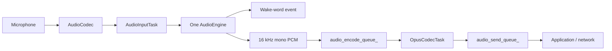

# Audio Service Architecture

`AudioService` owns one input engine and keeps codec I/O, Opus encoding/decoding,
and network queues independent from the chip-specific speech pipeline.

## Input engines

`AudioInputTask` reads PCM once and feeds exactly one `AudioEngine`.

| Target | Engine | Wake word | Uplink processing |
| --- | --- | --- | --- |
| ESP32-S3 / ESP32-P4 | `AfeAudioEngine` | WakeNet inside AFE, or MultiNet fed from AFE output | FD AEC + VAD when audio processing is enabled |

`AfeAudioEngine` owns a single FD AFE instance. WakeNet and voice uplink share
that instance, so enabling both creates only one AFE pipeline. For custom
MultiNet wake words, AFE fetch output is passed to `CustomWakeWord`.

The AFE configuration currently uses `FD_LOW_COST` AEC with
`AEC_NLP_LEVEL_VERYAGGR`. WebRTC/NSNet noise suppression is intentionally
disabled because the project does not ship an NSNet model.

### AEC reference channel

AEC needs the speaker signal as an `R` input channel. Codecs with a hardware
loopback (ES8388 right ADC channel, ES7210 MIC3 on Box boards) provide it when
`CUSTOM_AUDIO_CODEC_AEC_REFERENCE` is enabled. Every other codec uses
`SoftAecReference` (`USE_SOFTWARE_AEC_REFERENCE`, on by default with device AEC):

- the I2S TX `on_sent` DMA callback copies each block right after it was sent to
  the speaker, so the reference is exactly what was played;
- the RX `on_recv` callback timestamps each microphone block, and microphone
  reads are always one DMA block long, so every frame has a known capture time;
- both timelines are smoothed against interrupt latency, each microphone frame
  is paired with the speaker samples played 3 ms ahead of its capture time, and
  a 24-tap Kaiser interpolator converts the speaker rate to the microphone rate;
- the microphone stream is delayed by one TX block plus margins (about 27 ms at
  24 kHz output, 37 ms at 16 kHz) so the matching speaker block is published.

`AudioCodec::input_channels()` and `input_reference()` include the software
channel, so the AFE input format becomes `MR` without engine changes.

When wake-word audio upload is enabled, the most recent two seconds of PCM are
stored in a single 64 KB PSRAM ring buffer. WakeNet and MultiNet share the same
cache implementation, and the encoder reads it one Opus frame at a time.

## Input data flow

Wake-word detection and voice processing are independent runtime states on the
same engine. On AFE targets, AEC stays active while wake-word detection is active
so playback reference remains available for wake-up during device playback. It
also stays active during voice processing when device AEC is requested.

## Output data flow

## Tasks and power management

- `AudioInputTask` reads codec input and feeds the selected engine.
- `AudioOutputTask` drains decoded PCM to the codec output.
- `OpusCodecTask` encodes uplink PCM and decodes downlink packets.
- `AfeAudioEngine` has its own AFE fetch task on S3/P4.

The audio power timer enables and disables codec ADC/DAC channels based on
activity.

## Queue and allocation policy

The service queues use compile-time fixed-capacity storage and never allocate on
growth. `AudioTask` values are stored directly, and Opus encoding writes into the
packet payload without a temporary output buffer.
